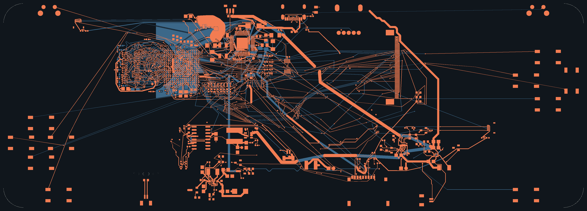

# Powered handheld I/O

The two amplifier control pads previously occupied separate physical nets from each other and from the V3V3_INTERNAL output. Two top-side connections join U_SPK_AMP.MUTE and U_SPK_AMP.SHND to C_3V3_OUT_B. These are the existing logic bias connections in the source design.

The drilled export retains 45 distinct DDR connections and reports 38 split whole-board nets, down from 39. All 21 DCDC4 CPU lands, all seven switched DDR CPU lands, direct DRAM supply, VTP, ZQ, VREF and the sequenced card supply retain their CAM connections. The DDR timing CSV matches e5fd49f byte for byte. No findings in the 0.102 mm copper, 0.1524 mm via-edge, drill spacing, self-contact, full-width DDR/MMC0/raster references, local DDR return or common-envelope checks. Startup and DDR timing remain open. [Physical land report](amp-logic-cam.txt)

## SYSBOOT10 and panel backlight control

U1.U3 now reaches R_SYSBOOT10.pin2 and the existing LCD_D10 panel copper. The bias is physically low and the sense net is isolated from the supply planes. U1.C18 reaches the backlight MOSFET gate through R_LCD_BL_PULLDOWN.pin1 on the same physical net. The chosen PWM path avoids an L2 segment that disconnected the A18 local return in a rejected trial. This verifies copper continuity; boot sampling, PWM operation and panel operation require first-article measurements.

Drilled CAM reports 36 split mapped nets, 45 distinct DDR links and no shorts between mapped lands. All 71 local DDR return terminals are covered by the connected plane, including A18. DDR timing is byte-for-byte identical to e5fd49f. There are zero copper, via-edge, drill, self-contact, DDR/MMC0/raster full-width reference and envelope findings. The 21 DCDC4 lands, seven switched supply balls, direct DRAM rail, both calibration resistors and sequenced MMC0 retain their physical connections. [Drilled CAM land report](sysboot10-backlight-cam.txt)

## SYSBOOT12 CPU tap

Drilled CAM joins U1.V2 to R_SYSBOOT12.pin2 and confirms isolated low bias. The panel-side LCD D12 FPC contact remains on a separate island. Six of the sixteen strap states are now physically resolved. This checkpoint retains the preceding SYSBOOT10 and PWM connections, all 45 distinct DDR links, the same timing CSV, full-width DDR/MMC0/raster reference and all 71 local return terminals. Copper, via-edge, drill, self-contact and envelope checks pass. [Exact land memberships and boot word](sysboot12-cam.txt)

## SYSBOOT7 CPU tap

U1.T4 now reaches R_SYSBOOT7.pin2. Drilled CAM confirms an isolated low strap and seven resolved strap states. The remaining panel-side LCD D7 land is listed in the physical report. The exported board retains the same 45 DDR links and timing, powered N5/P5, calibration and all 71 reference terminals. Full-width DDR, MMC0 and raster coverage pass, as do copper, drill, via-edge, self-contact and common-envelope checks. [Exact boot straps and physical land groups](sysboot7-cam.txt)

## Touch IRQ on the powered 45-link orientation

The exported copper connects U1.V14 to R_TOUCH_IRQ.pin1, and the resistor bias joins the sequenced 3.3 V rail. The IRQ route from the rotated study clears the powered board's SYSBOOT10 and SYSBOOT12 traces. Reusing the IRQ from 4b3d1c5 instead crossed both traces on L3. The verified export has 35 split mapped nets, previously 36. All mapped ground lands and barrels still join the UART ground probe. The IRQ connection alone does not qualify the touch panel.

The previous 45 DDR links, full timing CSV, N5/P5, VTP, MMC0 and 71 DDR local return terminals remain intact. All full-width reference, class spacing, drill, 0.102 mm copper and separate 6 mil via-edge checks pass on this partial DDR design. [Drilled endpoint audit](touch-irq-powered-cam.txt) · [Geometry and regression checks](touch-irq-powered-checks.txt)

## Panel-side LCD D4 connection

R_SYSBOOT4 pin 2 now reaches the panel's LCD D4 contact. The number of panel data contacts connected to their strap sense nodes is 11/16. The CPU land for this bit is still on its own island. Seven strap levels reach the CPU and 35 mapped board nets remain split. All 45 DDR links, the timing CSV, powered lands, 71 local DDR returns, handheld ground, and sequenced MMC0 remain intact. Full-width raster and DDR references, class and copper spacing, and separate drill and via-edge checks pass. [Drilled endpoints](panel-tap-4-cam.txt) · [Physical gates](panel-tap-4-geometry.txt)

## Panel-side LCD D3 connection

R_SYSBOOT3 pin 2 now reaches the panel's LCD D3 contact. The number of panel data contacts connected to their strap sense nodes is 12/16. The CPU land for this bit is still on its own island. Seven strap levels reach the CPU and 35 mapped board nets remain split. All 45 DDR links, the timing CSV, powered lands, 71 local DDR returns, handheld ground, and sequenced MMC0 remain intact. Full-width raster and DDR references, class and copper spacing, and separate drill and via-edge checks pass. [Drilled endpoints](panel-tap-3-cam.txt) · [Physical gates](panel-tap-3-geometry.txt)

On this powered orientation, the archived RTC paths from 25e6cfe were checked with the present pad locations and copper. B4 reaches the intended pin coordinates but the archived path has five layer/object clearance conflicts, including the backlight route. Both archived B5 and C5 paths intersect DDR_A8. All three also enter the common DDR clearance envelope. The archived SYSBOOT0 path has ten layer/object conflicts. Recomputing the SYSBOOT1 approach from U1.R2 at (−50.799988, 10.749958) to R_SYSBOOT1 pin 2 at (−32.750000, 6.432816) still leaves no allowed launch on the CPU land. The same bounded launch search failed at R1, R3, R4 and T1 with the DDR routing fixed. The verified panel contacts for bits 0–4 do not establish a boot strap until their CPU lands connect. Boot qualification and release remain open.

## Panel-side LCD D7 connection

R_SYSBOOT7 pin 2 now reaches the panel's LCD D7 contact. The number of panel data contacts connected to their strap sense nodes is 13/16. The existing U1.T4 strap now also reaches the panel. Eight of 29 raster CPU-to-connector links close, seven strap levels reach the CPU, and 34 mapped board nets remain split. All 45 DDR links, the timing CSV, powered lands, 71 local DDR returns, handheld ground, and sequenced MMC0 remain intact. Full-width raster and DDR references, class and copper spacing, and separate drill and via-edge checks pass. [Drilled endpoints](panel-tap-7-cam.txt) · [Physical gates](panel-tap-7-geometry.txt)

The initial D7 trial left 0.0098343 mm² of top-layer trace without a connected L2 reference. Rerouting its resistor-side launch around the void removed that finding. The final export checks 1,145 plated barrels.

## Touch SDA on the powered handheld

Drilled CAM connects the CPU's touch SDA signal to its fitted pull-up. The pull-up bias is on sequenced DCDC4. All 45 DDR links, 71 reference terminals, all handheld grounds, and the complete published DDR timing CSV are preserved. Full-width DDR, MMC0 and raster references and separate copper, 6 mil via-edge and drill checks pass. The full board has 33 split mapped nets. This measurement covers the CPU and bias resistor. Panel operation requires the remaining touch integration. [Drilled CAM](touch-SDA-cam.txt) · [Geometry checks](touch-SDA-geometry.txt)

## Touch SCL on the powered handheld

Drilled CAM connects the CPU's touch SCL signal to its fitted pull-up. The pull-up bias is on sequenced DCDC4. All 45 DDR links, 71 reference terminals, all handheld grounds, and the complete published DDR timing CSV are preserved. Full-width DDR, MMC0 and raster references and separate copper, 6 mil via-edge and drill checks pass. The full board has 32 split mapped nets. This measurement covers the CPU and bias resistor. Panel operation requires the remaining touch integration. [Drilled CAM](touch-SCL-cam.txt) · [Geometry checks](touch-SCL-geometry.txt)

## Panel-side LCD D5 connection

R_SYSBOOT5 pin 2 now reaches the panel's LCD D5 contact. The number of panel data contacts connected to their strap sense nodes is 14/16. The CPU land for this bit is still on its own island. Seven strap levels reach the CPU and 32 mapped board nets remain split. All 45 DDR links, the timing CSV, powered lands, 71 local DDR returns, handheld ground, and sequenced MMC0 remain intact. Full-width raster and DDR references, class and copper spacing, and separate drill and via-edge checks pass. [Drilled endpoints](panel-tap-5-cam.txt) · [Physical gates](panel-tap-5-geometry.txt)

## Powered LCD D12

U1.V2, R_SYSBOOT12 pin 2 and J_LCD pin 15 now share one drilled CAM island. Local changes to D4, D11 and PCLK retain their full-width return around the new D12 transitions. All 45 DDR links, their timing CSV, 71 local return terminals, the sequenced MMC0 supply and seven signals retain their prior results. The full panel has 9/29 end-to-end signals and 15/16 strap taps. Seven CPU boot straps are physically resolved. There are 31 split mapped nets. [Drilled CAM](panel-D12-cam.txt) · [Physical checks](panel-D12-geometry.txt) · [Full-board PCB](powered-panel-taps.png)

## All sixteen panel strap taps

R_SYSBOOT6 pin 2 reaches J_LCD pin 24 through a staggered blind/buried transition. All 16 panel-side strap taps are physically connected. The U1.T3 land for bit 6 remains isolated. Nine of 29 CPU-to-panel signals and seven physical CPU strap states are verified. Drilled CAM retains 45 DDR links and counts 1,205 plated barrels. Full-width DDR, MMC0 and raster references, all local power/return checks, 0.102 mm copper, 0.1524 mm via-edge and drill spacing pass. There are 31 split mapped nets. [Physical endpoints](panel-D6-cam.txt) · [Geometry](panel-D6-geometry.txt) · [Full PCB](powered-panel-taps.png)

## Powered LCD D16

U1.U13 reaches J_LCD pin 33 through nine plated transitions. The raster reference check covers the entire D16 trace. Ten of 29 CPU-to-panel signals, all sixteen panel-side strap taps and seven CPU strap states are connected. Drilled CAM finds 30 split mapped nets. The 45 DDR links retain their complete prior timing CSV, physical power lands and 71 local returns. The checks cover physical connection and reference. Panel setup and hold relative to PCLK remain open. [Drilled CAM](panel-D16-cam.txt) · [Geometry](panel-D16-geometry.txt) · [Full PCB](powered-panel-taps.png)

## Powered LCD D17

U1.V13 reaches J_LCD pin 17 through thirteen plated transitions. The raster reference check covers the entire D17 trace. Eleven of 29 CPU-to-panel signals, all sixteen panel-side strap taps and seven CPU strap states are connected. Drilled CAM finds 29 split mapped nets. The 45 DDR links retain their complete prior timing CSV, physical power lands and 71 local returns. The checks cover physical connection and reference. Panel setup and hold relative to PCLK remain open. [Drilled CAM](panel-D17-cam.txt) · [Geometry](panel-D17-geometry.txt) · [Full PCB](powered-panel-taps.png)
