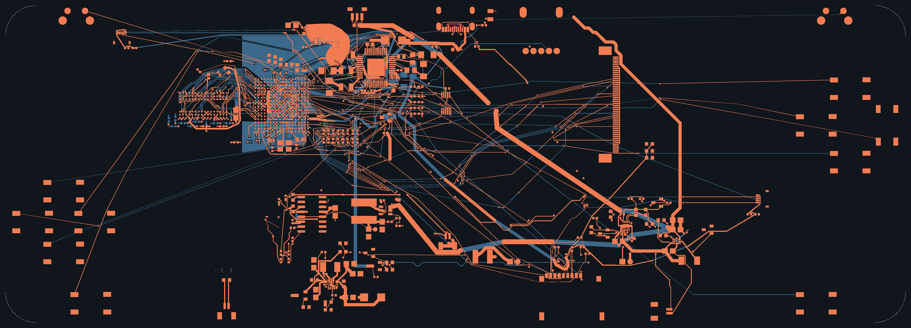

# BA2 breakout on the populated wide handheld

Amber shows the exported front copper, blue the back copper, and the pale outline the board edge. The image does not include the two internal planes.

BA2 raises the rotated trial to 25 distinct physical DDR links. The 1,035 drilled plated barrels show no shorts between mapped lands. N5/P5, VTP, VREF, all DDR supply lands, 71 return terminals, the MMC0 rail, seven MMC0 signals and SYSBOOT0 pass. The full-width reference and envelope checks, 0.102 mm copper and 0.1524 mm via-edge checks pass. Whole-board CAM reports 55 split nets. The data routes and both strobes retain their previously verified geometry.

BA2 is 34.7261 mm with two L1–L4 vias and an estimated 219.0791 ps flight. The rotated placement's project window is 34.950–37.490 mm, leaving a 0.2239 mm shortfall. It arrives +85.8962 ps after the current mean clock. Clock and receiver timing are open. The remaining 25 DDR signals are listed in the drilled CAM. The 45-link powered board remains the higher-connectivity fallback.

[Assembled circuit](handheld.circuit.json.gz) · [Lengths, prior/current estimated timing and actual targets](timing.csv) · [Drilled physical nets](drilled-cam.txt) · [Spacing, copper and reference checks](geometry-checks.txt)
