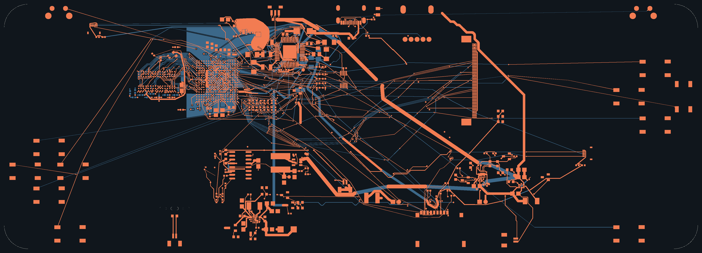

# D1 restored with both data groups on the populated board

Reallocating the lower strobe corridor and remapping D1 within byte 0 restores D1 alongside D2/D3/D4, D10/D11/D12/D14, both strobe pairs, CK/CKn, A10 and A14. D1 is 15.32602 mm with two L1–L4 transitions (2.840 mm copper-center barrel sum), 107.15981 ps estimated flight and +3.10462 ps worst signed skew against the separate ±3.66332 ps screen. Its TI strobe mismatch is 0.13799 mm against 0.635 mm. Its maximum present-peer mismatch is 0.14734 mm against 0.635 mm.

DQS0 and DQSn0 now measure 15.18803 mm each and have 11.06844 and 11.72684 mm within the 0.42 mm mate-proximity threshold. Their worst signed skew is ±0.10008 ps against ±0.71336 ps. D2/D3/D4 copper lengths remain the same. Their worst signed skews with the new pair are +2.35569, +2.25463 and +2.54752 ps. All eight installed DQ conductors pass the measured subset's TI geometry and modeled skew gates. Full-byte matching also depends on the eight missing DQ conductors and two masks.

CAM verifies 26 distinct DDR links, 1,037 plated barrels and zero shorts between mapped lands. The common DDR envelope, full-width reference, all 71 DDR returns, 0.102 mm copper, 0.1524 mm via-edge spacing, drill spacing and DDR class checks pass. The power and calibration endpoints including N5/P5, VTP, VREF and MMC0 remain connected. Whole-board CAM counts 54 split nets.

With these 26 links frozen, a two-transition search on a 0.045 mm grid found no remaining lower- or upper-byte data path within its present strobe and peer timing window. The same grid screen also failed for the remaining bits before the 14 command and clock traces were added. This is a bounded search. Completing the bytes needs further coordinated escape or placement work.

The project command window and actual receiver timing remain open. An isolated B4-to-D7 RTC supply path passed physical continuity but cut off the G12 ground return. That power path is excluded from this checkpoint. No fabrication release.

[Board circuit](handheld.circuit.json.gz) · [Byte 0 prior/current and limits](byte0.csv) · [Byte 1 prior/current and limits](byte1.csv) · [All 50 signals with timing and command residuals](timing.csv) · [Drilled CAM](drilled-cam.txt) · [Geometry checks](geometry-checks.txt)

The rotated byte-1 placement gate is 14.2000 mm. All four routed data traces and both strobes exceed it. Their relative length matching and skew screens still pass. Across every same-byte DQ permutation with the mask and strobes fixed, the largest possible project gate is 14.99986 mm. Holding the 16.8141 mm strobe length would still miss by at least 1.81424 mm. Completing byte 1 therefore requires shorter geometry or a different placement. These placement gates are project criteria. TI specifies DQLM1 as a typical value. [Per-net remap bound](remap-length-bound.csv)
