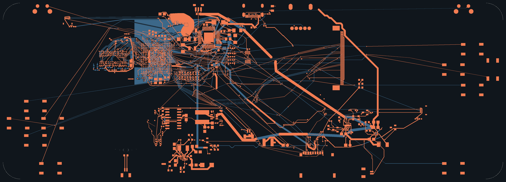

# Route RTC reset to B5 and preserve the complete handheld ground network

Drilled CAM on the populated board gives these connectivity results.

- Startup copper PASS U1.B4 to U1.D7.
- Startup copper PASS U_PMIC.PGOOD_BU to U1.B5.
- Startup copper PASS U_PMIC.nWAKEUP to U1.C5.
- RTC isolation PASS U1.B4 from U1.D6.
- SYSBOOT07 bias=0 CPU_to_resistor=True sense_isolated=True
- Physical SYSBOOT[15:0] 010000??0??????1, expected 0100000000010111.
- U1 DDR bypass to U_DDR_SWITCH.VOUT1: 22/22 supplied, 0 on copper shared with the other load domain.
- U_DDR DDR bypass to C_PMIC_DDR.pin1: 14/14 supplied, 0 on copper shared with the other load domain.
- MMC0 sequenced card power and seven distinct links: PASS
- 51 mapped land nets have multiple physical networks.
- 26 distinct DDR ball pairs connected. 1057 plated barrels checked. No shorts between mapped land nets.

The CPU and RAM power lands, all 71 local DDR reference terminals and the prior passing bootstrap and bypass connections remain physically intact. The full DDR timing CSV is byte-identical to the D1-restored checkpoint. Physical startup connectivity is one prerequisite for first-article testing. Sequencing waveforms, cold boot, full-byte and receiver timing, and complete board connectivity remain open.

[Assembled board](handheld.circuit.json.gz) · [Exact CAM](drilled-cam.txt) · [Geometry and regression checks](geometry-checks.txt) · [Unchanged DDR timing](../d1-restored/timing.csv)

The reset escape preserves continuous L2 ground paths from the CPU bypass return vias to the main ground plane. Independent drilled CAM verifies that all mapped handheld ground lands and barrels join the UART ground probe.

[Whole-board ground and startup CAM](whole-ground-cam.txt)
